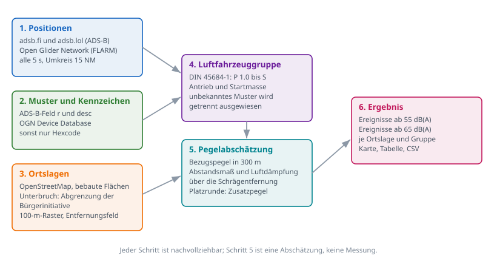
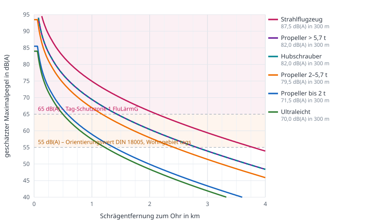

# Methodik: Was Flugspur erfasst, warum, und worauf es sich stützt

Dieses Dokument beschreibt vollständig, welche Daten Flugspur erhebt, aus
welchen Quellen, nach welchen Regeln ausgewertet wird und welche
regulatorischen Grundlagen dabei herangezogen werden.

Es ist bewusst so geschrieben, dass es einer kritischen Prüfung standhält.
Wer unsere Zahlen anzweifelt, soll hier nachlesen können, wie sie zustande
kommen — einschließlich dessen, was wir **nicht** wissen und **nicht**
behaupten.

Stand: siehe Git-Historie dieser Datei. Änderungen an Annahmen sind dort
zeilenweise nachvollziehbar; das ist der Grund, warum diese Dokumentation
im Repository liegt und nicht als PDF herumgereicht wird.

---

## 1. Zweck und Grenzen

**Was dieses Werkzeug leisten soll:** Nachvollziehbar dokumentieren, wie
oft, wie tief und mit welchem Luftfahrzeugtyp Wohngebiete rund um den
Flugplatz Mönchengladbach (EDLN) überflogen werden, und wie laut das
schätzungsweise ist.

**Was es ausdrücklich nicht leistet:**

* Es ist **keine Lärmmessung**. Es gibt keine Mikrofone. Alle Pegel sind
  aus Flugspur und Luftfahrzeugmuster **gerechnet**.
* Es ist **kein Gutachten** nach DIN 45684-1. Ein Gutachten rechnet mit
  Flugbewegungszahlen eines ganzen Bezugsjahres, mit Flugkorridoren und
  mit Oktavspektren; es liefert Dauerschallpegel. Wir liefern
  Einzelereignisse.
* Es beweist **keinen Rechtsverstoß**. Ein Überflug ist zunächst nur ein
  Überflug. Siehe Abschnitt 7.

**Die erhobenen Zahlen sind durchweg Untergrenzen.** Jedes Luftfahrzeug,
das keinen Transponder mitführt oder dessen Signal uns nicht erreicht,
fehlt. Siehe Abschnitt 8.

---

## 2. Welche Daten erfasst werden und warum



### 2.1 Positionsdaten

| Quelle | Was sie liefert | Warum wir sie nutzen |
|---|---|---|
| `opendata.adsb.fi` | ADS-B-Positionen, Kennzeichen, Musterkürzel, Klartextmuster | frei, ohne Anmeldung, liefert als einzige das Feld `desc` im Klartext |
| `api.adsb.lol` | dieselben Felder außer `desc` | zweite Quelle, schließt Lücken der ersten |
| Open Glider Network, `aprs.glidernet.org` | FLARM- und OGN-Positionen | erfasst Segelflug, Ultraleicht und Motorsegler, die oft kein ADS-B senden |

Abgefragt wird alle **5 Sekunden** im Umkreis von **15 NM** (rund 28 km) um
den Flugplatz, bis **10.000 ft**. Gespeichert werden je Meldung: Zeitstempel,
Kennung, Position, Höhe, Kurs, Geschwindigkeit, Musterkürzel, Kennzeichen.

Das Abfrageintervall ist ein Kompromiss: Bei 5 Sekunden legt ein
Schulflugzeug rund 250 m zurück, das reicht für die Rekonstruktion einer
Platzrunde. Kürzere Intervalle würden die Quellen unnötig belasten; das
Datenvolumen liegt so bei 40 bis 80 MB im Monat.

### 2.2 Luftfahrzeugkennzeichen

Die Zuordnung erfolgt dreistufig: zuerst das ADS-B-Feld `r`, dann die
**OGN Device Database**, sonst bleibt nur der Hexcode.

**Datenschutzhinweis, der zur Ehrlichkeit gehört:** Luftfahrzeugkennzeichen
lassen über das Luftfahrzeugregister Rückschlüsse auf Halter zu. Die OGN
Device Database enthält selbst keine Halterdaten, und wer nicht
veröffentlicht werden will, kann bei OGN widersprechen und fehlt dann in
unseren Daten. Wir werten Kennzeichen aus, um **Muster und Betreiber**
(Flugschule, Verein, Privat) zu unterscheiden — nicht, um einzelne Piloten
an den Pranger zu stellen. Veröffentlichungen sollten entsprechend
aggregiert erfolgen.

### 2.3 Ortslagen

Die bebauten Flächen stammen aus **OpenStreetMap** (© OpenStreetMap-
Mitwirkende, ODbL). Sie werden einmalig je Flugplatz geladen und auf ein
**100-m-Raster** abgebildet, aus dem ein Entfernungsfeld bis 4.000 m
berechnet wird. Damit lässt sich für jeden Punkt in konstanter Zeit sagen,
wie weit er von der nächsten bebauten Fläche der jeweiligen Ortslage
entfernt ist.

Zwei Abweichungen sind dokumentationspflichtig:

* **Schiefbahn-Unterbruch:** OpenStreetMap führt hier nur einen Punkt und
  wenige Gebäudeflächen, zusammen rund 3 Hektar. Das greift zu kurz. Die
  Abgrenzung des Gebiets stammt deshalb von der Bürgerinitiative und wurde
  aus einer Kartenmarkierung über drei Passpunkte in Koordinaten
  umgerechnet. Restabweichung der Passpunkte: **bis etwa 50 m**. Für eine
  Gebietsgrenze ausreichend, für Aussagen über einzelne Grundstücke nicht.
* **Kaarst-Vorst** endet an Holzbüttgen; Holzbüttgen ist eine eigene
  Ortslage, damit Vorst keine fremden Bewegungen zugerechnet bekommt.

Beide Festlegungen stehen in `app/plaetze/zonen_edln.json` und sind dort
änderbar, ohne dass Code angefasst werden muss.

---

## 3. Regulatorische Grundlagen

Wir berufen uns auf das Regelwerk, mit dem in Deutschland Fluglärm
tatsächlich beurteilt wird. Wichtig ist die Unterscheidung zweier Welten:

### 3.1 Welches Recht für welchen Flugplatz gilt

**Gesetz zum Schutz gegen Fluglärm (FluLärmG)** mit der *Anleitung zur
Berechnung von Lärmschutzbereichen (AzB, 2008)* und der *Anleitung zur
Datenerfassung (AzD)* gilt für Flugplätze, für die ein Lärmschutzbereich
festgesetzt wird — also für Verkehrsflughäfen wie Düsseldorf.

**Mönchengladbach ist ein Landeplatz.** Für Landeplätze wird kein
Lärmschutzbereich festgesetzt. Maßgeblich ist stattdessen die
**LAI-Landeplatz-Fluglärmleitlinie** in Verbindung mit
**DIN 45684-1** („Akustik — Ermittlung von Fluggeräuschimmissionen an
Landeplätzen, Teil 1: Berechnungsverfahren"). Die Leitlinie liefert das
Beurteilungsverfahren, die Norm das Rechenverfahren und die
Emissionsdaten.

Eine Schwelle aus der Leitlinie ist für die Einordnung von EDLN nützlich:
Auf eine Ermittlung der Fluglärmimmissionen darf nur verzichtet werden, wenn
ein Landeplatz **weniger als 5.000 motorgetriebene Flugbewegungen** im
Bezugsjahr hat **und** die 50-dB(A)-Kontur das Flugplatzgelände nicht
verlässt. Mönchengladbach liegt deutlich darüber.

### 3.2 Die Zahlenwerte, an denen wir uns orientieren

| Wert | Herkunft | Bedeutung |
|---|---|---|
| **55 dB(A)** | DIN 18005-1 Beiblatt 1, Orientierungswert allgemeines Wohngebiet, tags | Vergleichsmaßstab der Landeplatz-Fluglärmleitlinie |
| **65 dB(A)** | FluLärmG § 2 Abs. 2 Nr. 2, Tag-Schutzzone 1, bestehende zivile Flugplätze | deutlich wahrnehmbare Störung |
| 60 dB(A) | FluLärmG, Tag-Schutzzone 2, bestehende zivile Flugplätze | nachrichtlich |
| 55 dB(A) nachts / 6 × 57 dB(A) | FluLärmG, Nacht-Schutzzone, bestehende Flugplätze | für EDLN kaum relevant (kein nennenswerter Nachtflug) |
| 40 dB(A) nachts außen | WHO-Empfehlung | strengster der hier genannten Maßstäbe |

Zur Einordnung der Landeplatz-Leitlinie: Sie empfiehlt, **Maßnahmen
einzuleiten**, wenn die Orientierungswerte der DIN 18005 um mindestens
5 dB überschritten werden, und **Maßnahmen zu erwägen** bei geringerer
Überschreitung.

### 3.3 Weitere einschlägige Vorschriften

* **LuftVO** — Mindestflughöhe von 600 m bei Überlandflügen nach
  Sichtflugregeln mit motorgetriebenen Luftfahrzeugen. In der Platzrunde
  gilt diese Mindesthöhe nicht.
* **Landeplatz-Lärmschutz-Verordnung** — Betriebsbeschränkungen für
  Luftfahrzeuge, die erhöhte Schallschutzanforderungen nicht erfüllen.
* **ICAO Annex 16** — Lärmzertifizierung; die Kapitelzugehörigkeit
  bestimmt bei Propellerflugzeugen über 5,7 t die Gruppenzuordnung.
* **DIN 45643** — Messung und Beurteilung von Flugzeuggeräuschen. Das
  wäre die Grundlage, wenn wir tatsächlich messen würden. Tun wir nicht.

### 3.4 Was ausdrücklich *keine* Rechtsgrundlage ist

Die Platzrunden und die Vereinbarung, Schiefbahn-Unterbruch nicht zu
überfliegen, beruhen auf einer **Empfehlung des Lärmschutzbeirats**. Es
gibt dafür **keine verbindliche Mindestflughöhe und keine
Transponderpflicht**. Eine Abweichung ist daher in aller Regel **kein
Rechtsverstoß**, sondern das Nichteinhalten einer freiwilligen
Selbstverpflichtung. Diese Unterscheidung ist für die Glaubwürdigkeit der
Auswertung entscheidend und steht deshalb auch in jeder erzeugten
Auswertung.

Eine Änderung der Platzrunde ist hoheitliche Aufgabe der
**Bezirksregierung**, nicht des Flugplatzbetreibers.

---

## 4. Einteilung der Luftfahrzeuge

DIN 45684-1 teilt Luftfahrzeuge nach **Antriebsart und Höchststartmasse**
in Gruppen ein. Jede Gruppe hat einen eigenen Emissionsdatensatz. Wir
übernehmen diese Systematik:

| Gruppe | Definition | typische Muster bei EDLN |
|---|---|---|
| P 1.0 | Ultraleichtflugzeuge | WT9, CTLS, EV97 |
| P 1.1 | Motorsegler | Dimona, SF 25 |
| P 1.2 / P 1.3 | Propellerflugzeuge bis 2,0 t | C152, C172, PA28, DR400, DA40, SR20 |
| P 1.4 | Propellerflugzeuge 2,0 bis 5,7 t | DA42, PC-12, Cessna 208 |
| P 2.1 / P 2.2 | Propellerflugzeuge über 5,7 t | King Air 350, Dash 8 |
| S | Strahlflugzeuge | Citation, Learjet, Airbus/Boeing im Durchgangsverkehr |
| H | Hubschrauber | EC135, R44 |

Die Zuordnung erfolgt über das **ICAO-Musterkürzel** aus der ADS-B-Meldung,
hilfsweise über Schlüsselwörter in der Klartextbeschreibung. **Lässt sich
ein Muster nicht zuordnen, wird es als „Muster unbekannt" getrennt
ausgewiesen** und nicht stillschweigend einer Gruppe zugeschlagen — sonst
stünde eine erfundene Zahl in der Statistik. Für die Pegelrechnung wird in
diesem Fall ersatzweise mit der häufigsten Gruppe (Propeller bis 2 t)
gerechnet; das ist im Zweifel die konservative, also leisere Annahme.

Die Zuordnungstabelle steht in `app/laerm.py` und ist dort erweiterbar.

---

## 5. Die Pegelabschätzung

### 5.1 Bezugspegel

Die Landeplatz-Fluglärmleitlinie gibt für jede Luftfahrzeuggruppe
Oktavpegel bei der Bezugsentfernung **300 m** an. Diese acht Oktavwerte
wurden A-bewertet und energetisch aufsummiert. Daraus ergeben sich die
Bezugspegel:

| Gruppe | L_pAmax in 300 m |
|---|---|
| Ultraleicht / Motorsegler | 70,0 dB(A) |
| Propeller bis 2 t | 71,5 dB(A) |
| Propeller 2 bis 5,7 t | 79,5 dB(A) |
| Propeller über 5,7 t | 82,0 bis 85,0 dB(A) |
| Hubschrauber | 82,0 dB(A) |
| Strahlflugzeug | 87,5 dB(A) |

Zwischen einem Schulflugzeug und einem Strahlflugzeug liegen damit rund
**16 dB**. Das entspricht dem Faktor **6,3 in der Entfernung**: Ein Jet ist
in 1,9 km so laut wie eine Cessna in 300 m. Genau deshalb reicht eine
einheitliche Entfernungsschwelle für alle Luftfahrzeuge nicht aus.

### 5.2 Zusatzpegel für die Platzrunde

Die Leitlinie setzt den Horizontalflugteil in der Platzrunde ausdrücklich
lauter an — Ultraleicht +6 dB, Motorsegler +4 dB, Propellerflugzeuge bis
5,7 t +2 dB, schwere Propellerflugzeuge +5 dB, Strahlflugzeuge +3 dB. Das
ist bemerkenswert, weil Platzrundenbetrieb genau der Betrieb ist, der an
einem Schulflugplatz dominiert.

### 5.3 Ausbreitungsrechnung

Maßgeblich ist die **Schrägentfernung**, also der tatsächliche Abstand
zwischen Luftfahrzeug und Immissionsort:

```
s = Wurzel( seitlicher Abstand² + Flughöhe über Grund² )
```

Daraus der Pegel:

```
L(s) = L(300 m) − 20 · log10(s / 300 m) − 3 dB/km · (s − 300 m)
```

Der erste Abzug ist das Abstandsmaß (6 dB je Entfernungsverdopplung), der
zweite die Luftabsorption, grob über das A-bewertete Spektrum gemittelt.



Daraus ergeben sich die Entfernungen, bei denen die Schwellen
unterschritten werden (ohne Platzrundenzuschlag):

| Gruppe | 65 dB(A) bei | 55 dB(A) bei |
|---|---|---|
| Ultraleicht | 498 m | 1.225 m |
| Propeller bis 2 t | 576 m | 1.381 m |
| Propeller 2 bis 5,7 t | 1.177 m | 2.421 m |
| Propeller über 5,7 t | 1.435 m | 2.816 m |
| Hubschrauber | 1.435 m | 2.816 m |
| Strahlflugzeug | 2.128 m | 3.790 m |

### 5.4 Was in dieser Rechnung fehlt

Damit niemand mehr hineinliest, als drinsteht — **nicht berücksichtigt**
sind: Triebwerksleistung und Propellerdrehzahl im konkreten Flugzustand,
Steig- oder Sinkflug, Wind und Temperaturschichtung, Bodendämpfung und
Bodenreflexion, Abschirmung durch Bebauung, Richtwirkung der Quelle sowie
die Überlagerung mehrerer gleichzeitiger Ereignisse.

Die Abweichung im Einzelfall kann daher **mehrere Dezibel** betragen. Für
eine rechtsfeste Aussage braucht es Messungen nach DIN 45643.

Wofür die Abschätzung trotzdem taugt: Sie macht Ereignisse **untereinander
vergleichbar** und ordnet sie in die Größenordnungen ein, mit denen
Behörden arbeiten.

---

## 6. Zählregeln

* **Ein Ereignis** entsteht, sobald der geschätzte Maximalpegel an einer
  Ortslage **55 dB(A)** erreicht. Während des Durchgangs wird der lauteste
  Wert festgehalten.
* **Entprellung 180 Sekunden:** Kommt dasselbe Luftfahrzeug innerhalb von
  drei Minuten erneut, gilt das als derselbe Durchgang. Eine Platzrunde
  mit typisch 6 bis 8 Minuten Umlaufzeit wird dadurch korrekt als mehrere
  Ereignisse gezählt, ein kurzes Zickzack über derselben Stelle nicht.
* Ein Ereignis wird **je Ortslage** gezählt. Ein Flug zwischen zwei Orten
  kann in beiden auftauchen — das ist beabsichtigt, denn Schall hört nicht
  an der Gebietsgrenze auf.
* **Spurtrennung:** Bei einer Lücke von mehr als 120 Sekunden wird eine
  neue Flugspur begonnen, damit keine Geraden quer über die Karte
  entstehen.
* Am Boden stehende Maschinen (0 ft und unter 3 kt) werden ausgeschlossen.

---

## 7. Was die Zahlen aussagen — und was nicht

Zwei Hinweise sind fest in jede erzeugte Auswertung eingebaut:

1. **Die Zahlen sind Untergrenzen.** Nicht jedes Luftfahrzeug wird erfasst.
2. **Ein Überflug ist kein Rechtsverstoß.** Siehe Abschnitt 3.4.

Was sich aus den Daten seriös ableiten lässt: Häufigkeiten, Tages- und
Wochengänge, Verteilung über die Ortslagen, Anteil der Luftfahrzeuggruppen,
Höhenverteilung, Nutzung der Betriebsrichtungen, Veränderungen im
Zeitverlauf.

Was sich **nicht** ableiten lässt: der tatsächliche Schallpegel an einer
bestimmten Adresse, die Belästigungswirkung, die Einhaltung konkreter
Auflagen im Einzelfall, oder die Identität und Absicht eines Piloten.

---

## 8. Bekannte Lücken

| Lücke | Wirkung | Umgang damit |
|---|---|---|
| Keine Transponderpflicht für VFR-Verkehr an Landeplätzen | Ein Teil der Flüge fehlt vollständig | Zahlen werden durchgängig als Untergrenze bezeichnet |
| Empfangsabdeckung tiefer Flüge | tiefe Flüge im Nahbereich können fehlen | Vergleich mit Sichtbeobachtung im Testplan |
| MLAT-Positionen werden nur an Einspeiser zurückgeliefert | ungenauere oder fehlende Positionen | zwei Quellen parallel |
| Barometrische Höhe statt Höhe über Grund | Abweichung je nach Luftdruck | Gelände um EDLN ist nahezu eben, Fehler gering |
| Musterkürzel fehlt bei manchen OGN-Meldungen | Gruppenzuordnung unsicher | getrennt als „Muster unbekannt" ausgewiesen |
| Keine Messwerte | Pegel sind geschätzt | durchgängig gekennzeichnet |

---

## 9. Nachvollziehbarkeit

* Der vollständige Quelltext liegt im Repository. Die Auswertung ist
  **deterministisch**: Dieselben Rohdaten ergeben dieselbe Auswertung.
* Die **Rohdaten** werden als NDJSON aufbewahrt. Jede Zeile ist eine
  Positionsmeldung mit Zeitstempel und Quelle. Eine Auswertung lässt sich
  damit jederzeit mit geänderten Annahmen wiederholen.
* Alle **Annahmen stehen an genau einer Stelle**: die Bezugspegel und
  Schwellen in `app/laerm.py`, die Ortslagen in
  `app/plaetze/zonen_edln.json`, die Flugplatzparameter in
  `app/plaetze/edln.json`. Wird dort eine Zahl geändert, rechnet die
  Auswertung alle vorhandenen Daten neu durch.
* Die erzeugten Auswertungen sind **offline vollständig** — kein
  Nachladen aus dem Netz, keine externen Verweise. Eine Datei, die man
  archivieren oder per E-Mail weitergeben kann.
* Die Abbildungen dieses Dokuments werden mit
  `python3 doku/bilder_erzeugen.py` aus denselben Konstanten erzeugt, die
  auch die Auswertung verwendet. Sie können nicht veralten, ohne dass es
  auffällt.

---

## 10. Quellen

* Gesetz zum Schutz gegen Fluglärm (FluLärmG), insbesondere § 2 Abs. 2
* Anleitung zur Berechnung von Lärmschutzbereichen (AzB), 19.11.2008,
  BAnz. Nr. 195a vom 23.12.2008
* LAI-Leitlinie zur Ermittlung und Beurteilung der Fluglärmimmissionen in
  der Umgebung von Landeplätzen (Landeplatz-Fluglärmleitlinie)
* DIN 45684-1:2013-07, Akustik — Ermittlung von Fluggeräuschimmissionen an
  Landeplätzen, Teil 1: Berechnungsverfahren
* DIN 18005-1 Beiblatt 1, Schallschutz im Städtebau, Orientierungswerte
* DIN 45643:2011-02, Messung und Beurteilung von Flugzeuggeräuschen
* Luftverkehrs-Ordnung (LuftVO), Mindestflughöhen
* Landeplatz-Lärmschutz-Verordnung
* OpenStreetMap, © OpenStreetMap-Mitwirkende, ODbL
* Open Glider Network Device Database

---

## 11. Änderungen an dieser Methodik

Änderungen sind über die Git-Historie dieser Datei nachvollziehbar. Wer
eine Annahme ändert, sollte im Commit begründen, warum — insbesondere bei
den Bezugspegeln, den Schwellen und den Gebietsgrenzen.
